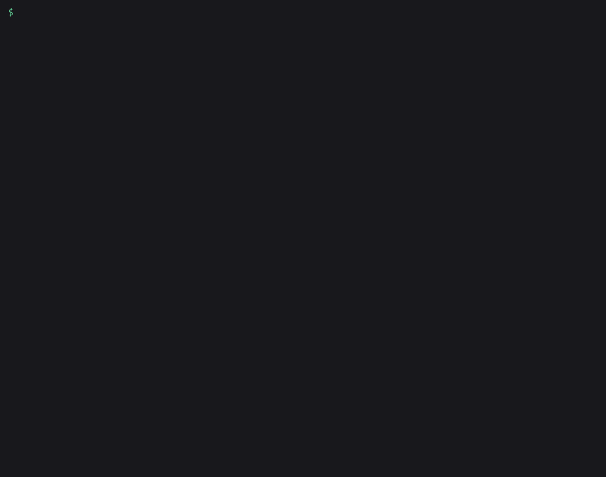
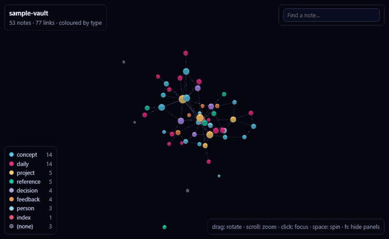
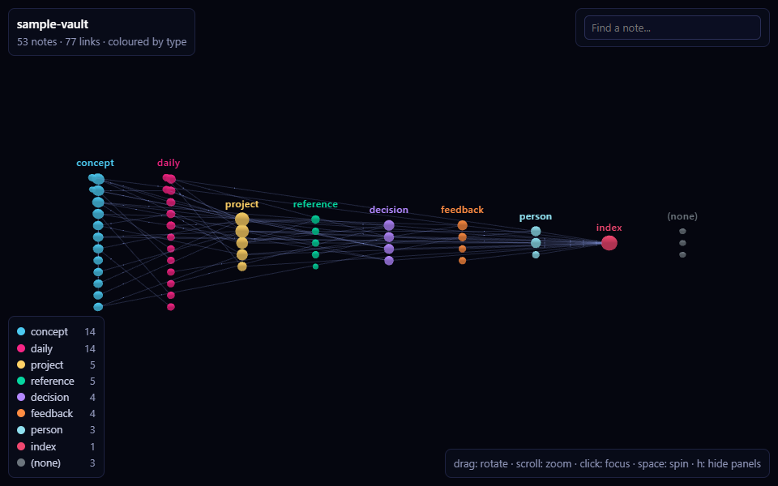

# amagi-vaultgraph

Turn a folder of markdown notes (an Obsidian vault, a Claude Code memory folder, a Foam or Logseq export) into one 3D graph you can open in a browser, plus a list of orphan notes, broken links, and links you probably meant to write.





## Install

```bash
pipx install amagi-vaultgraph
```

Not on PyPI yet. Until the first release, install from a clone with `pip install .` in the repo folder.

Python 3.9 or newer. No dependencies.

## Usage

```bash
vaultgraph path/to/vault
```

That writes `vaultgraph.html` and prints a report. Open the HTML file in a browser. Each note is a dot, each `[[wikilink]]` is a line, colour shows the note's type or folder, and size shows how many links it has. Drag to rotate, scroll to zoom, click a note to fly to it, type in the search box to find one.

This repo ships a made-up vault for a small software studio in `examples/sample-vault`: 53 notes, with a few problems left in on purpose. Real output:

```
$ vaultgraph sample-vault -o graph.html --limit 5
53 notes, 77 links, 5 orphans, 3 dangling links, 10 suggested links (coloured by type, 9 groups)
wrote graph.html (1.4 MB, 3d force, offline, names only)

HUBS  most-linked notes
   16  MEMORY (Studio Memory Index)
   13  projects/tidepool-api
   11  projects/lighthouse-app
    7  projects/driftwood-cli
    6  concepts/retry-with-backoff

ORPHANS (5)  no links in or out
  concepts/semantic-versioning
  inbox/release-versioning-notes
  inbox/untitled-2
  inbox/webhook-signing-idea
  reference/regex-snippets

DANGLING LINKS (3)  [[target]] matches no note
  concepts/retry-with-backoff -> [[rate-limitting]]  did you mean "concepts/rate-limiting"?
  daily/2026-09-17 -> [[q3-roadmap]]
  projects/beacon-newsletter -> [[q3-roadmap]]

SUGGESTED LINKS (10)
  inbox/webhook-signing-idea -> concepts/webhooks  similar name (0.29)
  projects/driftwood-cli -> concepts/semantic-versioning  mentions "Semantic Versioning"
  reference/release-checklist -> concepts/semantic-versioning  mentions "Semantic Versioning"
  concepts/caching-strategy -> concepts/observability  mentions "Observability"
  concepts/webhooks -> concepts/idempotency-keys  mentions "Idempotency Keys"
  ... 5 more (full list: --report FILE)
```

Orphans have no links in or out. A dangling link points at a note that doesn't exist; if a note name is close, you get a "did you mean".

Suggested links come from names alone. *mentions* means the source note's text contains the target's title, file name, or alias, but the two notes aren't linked. *similar name* means an orphan shares uncommon words with another note's name. Suggestions that would connect an orphan come first.

Nothing here uses an LLM or the network. The suggestions are plain string matching, so treat them as leads and check each one before you add the link.

### What the HTML file contains

The HTML file holds note names, folder paths, link counts, and colour groups. It does not hold any note text, so you can post a screenshot or send the file to someone without sending your notes. The report and the JSON export name notes too, and never quote them.

If you want hover previews for your own use, `--with-excerpts` adds the first ~280 characters of each note to the tooltips. It prints a warning when you do, because that file then contains your writing.

The graph library ([3d-force-graph](https://github.com/vasturiano/3d-force-graph)) is inlined by default, so the page works offline and makes no network requests. `--cdn` loads it from jsDelivr instead, pinned with a subresource integrity hash. For the sample vault that makes the file 15 KB instead of 1.4 MB.

### Layered view

```bash
vaultgraph sample-vault -o layered.html --layered
```

`--layered` puts each colour group in its own labelled column, biggest group on the left, best-connected notes at the top. Use it when you want to see how projects link to decisions, or which folder links into which.



### Colours

`--color-by auto` (the default) picks the first that fits:

1. `type`: the frontmatter `type:` field, or `metadata: type:` as Claude Code memory files write it. Used when at least half the notes have one.
2. `folder`: the top-level folder.
3. `prefix`: the file-name prefix, such as `project_` or `feedback_`. Useful for a flat folder like a Claude Code memory directory.

You can also pick one yourself, or use `tag` to colour by the first frontmatter tag.

### Fail CI on broken links

```bash
vaultgraph docs/ --check --no-html -q
```

Exit code 1 means orphans or dangling links were found. 0 means clean. 2 means a usage error, such as a folder with no notes in it.

### All options

```
vaultgraph VAULT [-o FILE] [--layered] [--color-by auto|type|folder|prefix|tag]
                 [--offline | --cdn] [--title TEXT] [--spin] [--with-excerpts]
                 [--exclude GLOB ...] [--report FILE] [--json FILE] [--no-html]
                 [--check] [--limit N] [-q] [--version]
```

- `--report FILE` writes the full report as markdown, with no row limit.
- `--json FILE` writes the graph and report as JSON, names only.
- `--exclude GLOB` skips files or folders (repeatable), for example `--exclude templates --exclude "*.excalidraw.md"`. Dot-folders such as `.obsidian`, `.git`, and `.trash` are always skipped.
- `--spin` slowly orbits the camera after the layout settles, which is handy for screen recordings. Press space in the page to toggle it, and `h` to hide the panels.
- `amagi-vaultgraph` is an alias for `vaultgraph`.

## How links are read

- `[[Note]]`, `[[Note|shown text]]`, `[[Note#Heading]]`, `[[Note^block]]`, `[[folder/Note]]`, and `![[Note]]` embeds. Embeds of images, PDFs, and other files are skipped.
- Relative markdown links to `.md` files, such as `[text](../other.md)`.
- A link matches a note by path, file name, frontmatter `title` or `name`, or an alias. Matching ignores case and treats spaces, hyphens, and underscores as the same, so `[[rate limiting]]` finds `rate-limiting.md`. When two notes share a name, the one closest to the linking note wins, as in Obsidian.
- Links inside code blocks and inline code are ignored.

## Use it from Claude Code

This repo ships a skill at `.claude/skills/amagi-vaultgraph/SKILL.md`. Copy that folder into your own `.claude/skills/` and Claude Code can map your memory folder, read the JSON report, and fix broken links with you.

## Limits

- Only `.md` and `.markdown` files are read.
- The frontmatter reader covers what notes usually contain: plain values, lists, and one nested level. It is not a full YAML parser.
- Logseq block references `((uuid))`, `#tags`, and Dataview queries do not become edges.
- Suggestions match names, not meaning. A note about "billing" won't be matched to one called "invoices".
- The HTML needs a browser with WebGL. A synthetic 2,000-note vault took about 2 seconds to process, and its graph rendered fine in headless Chromium.

## If this saved you time

A star helps other people find it.

## More from AmagiLabs

[github.com/amagilabs](https://github.com/amagilabs) has the other small open source dev tools from the same lab.

## License

MIT, see [LICENSE](LICENSE). Copyright (c) 2026 Amagisolutionsgroup, Inc. (AmagiLabs)

The vendored 3d-force-graph build (MIT) and the libraries it bundles are listed in [THIRD_PARTY_NOTICES.md](THIRD_PARTY_NOTICES.md). The default offline HTML output includes that build, so those notices apply to the files it writes too.
